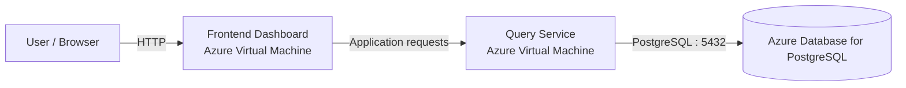

# Azure 3-Tier Application Deployment

A hands-on cloud deployment project demonstrating how a dashboard application can be organized across frontend, backend, and database tiers on Microsoft Azure.

> **Project type:** Learning / practice project
> **Deployment approach:** Manual deployment

## Overview

This project provisions the core Azure infrastructure for a three-tier application and manually deploys its components. The frontend dashboard runs on an Azure Virtual Machine, communicates with a backend query service on a separate VM, and uses Azure Database for PostgreSQL for persistence.

The repository documents the infrastructure and deployment workflow. Application source code remains in its respective upstream repositories.

## Architecture

### Tiers

| Tier | Azure component | Responsibility |
|---|---|---|
| **Frontend** | Azure Virtual Machine | Hosts the dashboard application and serves user requests. |
| **Backend** | Azure Virtual Machine | Runs the query service and handles application-side data requests. |
| **Database** | Azure Database for PostgreSQL | Stores application data and accepts PostgreSQL connections on port `5432`. |

## Azure Infrastructure

| Resource | Configuration |
|---|---|
| Resource group | `rg-axion-dev` |
| Virtual network | `vnet-axion` |
| VNet address space | `10.126.0.0/16` |
| Network segmentation | Frontend, backend, and database subnets |
| Compute | Separate frontend and backend virtual machines |
| Database | Azure Database for PostgreSQL |

## Deployment Workflow

1. Create the Azure resource group.
2. Configure the virtual network and frontend, backend, and database subnets.
3. Provision the frontend and backend virtual machines.
4. Configure Azure Database for PostgreSQL.
5. Retrieve each application component from its source repository.
6. Manually deploy the dashboard and query service to their respective tiers.
7. Open the dashboard using the frontend VM's public IP address.

## Source Repositories

The application components are maintained separately:

- `axion-dashboard` — frontend dashboard
- `axion-query-service` — backend query service
- `axion-database` — database-related project

Source code and licensing information belong to their respective repositories. Refer to those repositories for the latest details.

## Technology Stack

- Microsoft Azure
- Azure Virtual Machines
- Azure Virtual Network and subnets
- Azure Database for PostgreSQL
- GitHub

## Screenshots

Place the architecture diagram and deployed dashboard screenshots in the [`screenshots/`](screenshots/) folder. Add them here as the project visuals become available.

## Key Takeaways

- Provisioning and organizing Azure infrastructure
- Applying a three-tier architecture
- Deploying application components to virtual machines
- Working with virtual networks and subnet segmentation
- Understanding application-to-database connectivity
- Practicing a manual cloud deployment workflow
